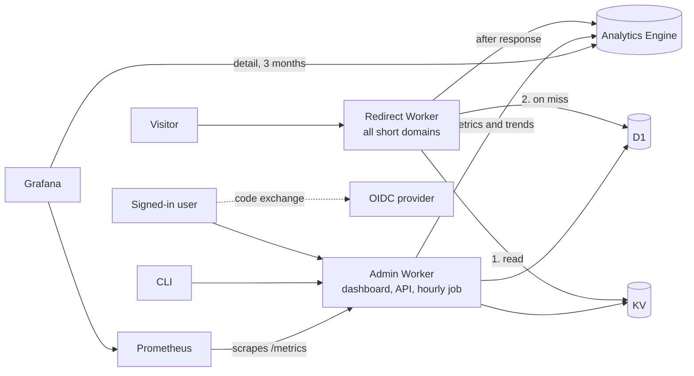

# Architecture

Status: built and tested locally, not deployed · 2026-11-25 · implements [PRD](PRD.md) draft 4

The project is `curt`. Examples use `go.example` for a short domain and `app.go.example` for the dashboard.

## 1. Overview



Two Workers share one D1 database, one KV namespace and one Analytics Engine dataset.

| Part | Responsibility |
|---|---|
| **Redirect Worker** | Resolve a slug, redirect, record the click. No framework, no sessions, no API token |
| **Admin Worker** | Static dashboard, JSON API, sign-in, `/metrics`, hourly maintenance. Sole writer of links |
| **CLI** | Go client for the JSON API |

Nothing runs in the owner's cluster.

## 2. Key decisions

| # | Decision | Why | Cost of it |
|---|---|---|---|
| 1 | Two Workers | Small redirect bundle; a bad dashboard deploy cannot break links; dashboard assets can be served free without shadowing slugs | Two deploys |
| 2 | D1 is truth, KV is the redirect copy | Fast hot reads with relational admin queries | KV can be stale |
| 3 | On a KV miss, read D1 | New links work at once, even after a cached miss | One D1 read per unknown slug |
| 4 | The redirect path never writes KV | A late write could overwrite a newer edit | A link missing from KV stays slower until repaired |
| 5 | Browser-side code exchange by default | Provider can stay private | Pinned keys |
| 6 | Grafana reads Analytics Engine directly | No collector | Detail limited to three months |
| 7 | `/metrics` is served by the Admin Worker, derived from Analytics Engine with no stored totals | Nothing to deploy; long history sits in the owner's Prometheus | Counters reset monthly; per-link series are capped |
| 8 | Dashboard on its own host | Session cookie is never sent to short domains | One extra DNS name |

## 3. Repository

```
workers/redirect/     TypeScript, no framework
workers/admin/        TypeScript, Hono, zod
web/                  Svelte and Vite single-page dashboard
packages/shared/      slug rules, KV codec, types, API schemas
migrations/           D1 SQL
cli/                  Go
grafana/              dashboard JSON and data source guide
dev/                  runs everything locally with stub services
scripts/              private-name check to run before pushing
spike/                throwaway test of private-provider sign-in
docs/                 PRD, architecture, operations
```

npm workspaces for TypeScript. Dependencies, including Wrangler, are pinned by lockfile and run through `npx`. `package.json` states the required Node version.

**Provenance rule:** a similar project, Sink, is AGPL-3.0. This project is MIT. Do not copy, port or consult its source.

## 4. Data

### D1

```sql
CREATE TABLE users (
  id TEXT PRIMARY KEY, issuer TEXT NOT NULL, subject TEXT NOT NULL,
  name TEXT, email TEXT, is_admin INTEGER NOT NULL DEFAULT 0,
  cutoff_at INTEGER,
  created_at INTEGER NOT NULL, UNIQUE (issuer, subject)
);
CREATE TABLE links (
  id TEXT PRIMARY KEY, domain TEXT NOT NULL, slug TEXT NOT NULL,
  destination TEXT NOT NULL, owner_id TEXT NOT NULL REFERENCES users(id),
  disabled INTEGER NOT NULL DEFAULT 0, expires_at INTEGER,
  version INTEGER NOT NULL DEFAULT 1, kv_version INTEGER NOT NULL DEFAULT 0,
  created_at INTEGER NOT NULL, updated_at INTEGER NOT NULL,
  UNIQUE (domain, slug)
);
CREATE INDEX links_owner ON links(owner_id, created_at, id);
CREATE INDEX links_created ON links(created_at, id);
CREATE INDEX links_slug ON links(slug);
CREATE INDEX links_unsynced ON links(id) WHERE kv_version < version;
CREATE TABLE tags (
  link_id TEXT NOT NULL REFERENCES links(id) ON DELETE CASCADE,
  tag TEXT NOT NULL, PRIMARY KEY (link_id, tag)
);
CREATE INDEX tags_tag ON tags(tag);
CREATE TABLE kv_deletes (
  kv_key TEXT PRIMARY KEY, requested_at INTEGER NOT NULL,
  confirmed INTEGER NOT NULL DEFAULT 0,
  link_id TEXT, owner_id TEXT
);
CREATE INDEX kv_deletes_link ON kv_deletes(link_id);
CREATE TABLE sessions (
  id_hash TEXT PRIMARY KEY, user_id TEXT NOT NULL REFERENCES users(id),
  expires_at INTEGER NOT NULL
);
CREATE TABLE used_nonces (nonce_hash TEXT PRIMARY KEY, expires_at INTEGER NOT NULL);
CREATE TABLE api_tokens (
  id TEXT PRIMARY KEY, user_id TEXT NOT NULL REFERENCES users(id),
  name TEXT NOT NULL, token_hash TEXT NOT NULL UNIQUE, scope TEXT NOT NULL,
  expires_at INTEGER, last_used_day TEXT, revoked_at INTEGER
);
CREATE TABLE audit (
  id TEXT PRIMARY KEY, at INTEGER NOT NULL, user_id TEXT NOT NULL,
  action TEXT NOT NULL, link_id TEXT, detail TEXT
);
```

A deleted link's slug may be reused. The new link has a new ID, so its stats start at zero.

### KV

Key `l:<domain>:<slug>`, both lowercase. Value is compact JSON: link ID, destination, version, `disabled`, `expires_at`. Expiry is checked on every redirect, so it takes effect on time even from a cached copy.

Key `salt:<UTC day>` holds the visitor-hash salt with a 48-hour expiry. Isolates keep it in memory, because reading it on every request would double KV use.

### Analytics Engine, one point per request

| Field | Value |
|---|---|
| index1 | link ID, or `none` |
| blob1 to blob8 | domain, slug, outcome, referrer domain, country, device type, bot flag, visitor |
| double1 | 1 |

`outcome` is `ok`, `not_found`, `disabled`, `expired` or `root`. `visitor` is empty, a keyed hash or the address, by configuration. Counts always use `SUM(_sample_interval * double1)`.

## 5. Redirect path

1. Normalize host and slug. Bare domain: redirect to the configured page. Reserved path: fixed response.
2. Read KV with the default 60-second cache.
3. On a miss, read D1 from the primary by `(domain, slug)`. Not found: 404.
4. Disabled or expired: 410.
5. Return 302 with `Cache-Control: private, no-store`.
6. Write the click point after the response is decided. Errors are swallowed and counted in logs.

If KV throws, go to step 3. If D1 also throws, return 503 with `Retry-After`.

D1 read replication stays off so step 3 sees new links.

## 6. Writing links

1. Validate, then write link, tags and audit row in one D1 batch. Edits increment `version`.
2. Write KV.
3. Re-read `version`. If it moved, write the newer value and repeat, at most three times.
4. Set `kv_version`.

Deletion removes the link and adds a `kv_deletes` row in the same batch, then deletes the KV key. The row stays as a tombstone: the hourly job deletes the key again and drops the row once it is at least 10 minutes old, in case a late write put the entry back. A slug that has been recreated is never deleted.

If KV fails, the write is retried shortly afterwards and the response says the change is pending. The hourly job finishes the work, disabled and deleted links first. Until then the old behaviour may continue. `resync` is an admin API action that rewrites every KV entry.

Random slugs use `crypto.getRandomValues` with rejection sampling over a 31-character alphabet, retrying on a unique-constraint conflict.

## 7. Sign-in

### Browser exchange (default)

1. Dashboard asks `POST /auth/begin`. The Worker creates a nonce, returns it, and stores it in a signed, HttpOnly, 10-minute cookie.
2. Dashboard creates the PKCE verifier and state in session storage and goes to the provider.
3. The provider returns to `/auth/callback`. The dashboard checks state and posts the code and verifier to the provider's token endpoint as a form.
4. Dashboard posts the ID token to `POST /auth/session`.
5. The Worker checks the signature against `OIDC_JWKS`, an algorithm allowlist, issuer, audience, expiry, issued-at, nonce cookie and allowed group. It clears the nonce cookie and, in one batch, records the nonce as used and creates a session, so a replay fails. A sign-in that began, or a token issued, at or before the person's latest cutoff is refused; a fresh sign-in afterwards is decided by the provider. Refusing someone for not being in the group also ends their sessions.

The token stays in memory and is dropped after step 4. The dashboard has no third-party scripts and a strict Content Security Policy whose `connect-src` is itself plus the provider.

### Server exchange

Same redirects, but the Worker keeps the verifier in the signed cookie, calls the token endpoint and fetches JWKS.

### Sessions and tokens

- Session: 256-bit random value in a `__Host-` cookie, HttpOnly, Secure, SameSite=Strict. Only its hash is stored. Seven days, not extended, so a removed person's session ends within a week. API tokens are separate: they last until they expire, are revoked, or an admin cuts the person off, and they carry the owner's admin status as of the last sign-in.
- API token: 256-bit random value with a recognizable prefix, stored as a SHA-256 hash. Scopes: `links` and `metrics:read`; only admins may create or use the latter.
- Cookie-authenticated writes require a matching `Origin`.
- SameSite=Strict means the first page load after the provider redirect carries no cookie; the callback page only needs the nonce cookie on its own later same-site request.

## 8. API

All under `/api/v1`, JSON, errors as `{"error":{"code","message"}}`, cursor pagination.

| Method and path | Purpose |
|---|---|
| `GET /links` | List and search: `q`, exact `slug`, `tag`, `domain`, `owner` (admin), `cursor` |
| `POST /links` | Create |
| `GET`, `PATCH`, `DELETE /links/{id}` | One link. `PATCH` requires `If-Match: <version>` |
| `GET /links/availability` | Slug check |
| `GET /links/{id}/qr` | SVG. The dashboard makes the PNG |
| `GET /links/{id}/stats` | Daily clicks for up to three months, from Analytics Engine |
| `GET /tags`, `GET /domains`, `GET /me` | Lookups |
| `GET`, `POST /tokens`, `DELETE /tokens/{id}` | API tokens, session only |
| `GET /users`, `POST /users/{id}/cutoff` | List people; end their sessions, revoke their tokens and clear admin. Admins only, session only, never yourself. Audited |
| `GET /export` | All of the caller's links, at most 500 per response with a cursor, which keeps within the free plan's CPU limit; admins get all |
| `POST /admin/resync` | Maintenance, admin only |

Members see and change only links they own. Ownership is enforced in the query, and someone else's link returns 404.

## 9. Hourly maintenance

One cron trigger, because the free plan allows five per account and 10 ms CPU each.

1. Finish pending KV writes and deletes, up to 40.
2. Make sure today's and tomorrow's salts exist.
3. Delete expired sessions.

The job does no click counting. It exists only for repair and housekeeping.

## 10. Grafana

- Detail: Altinity ClickHouse plugin against the SQL API.
- Older history and alerts: Prometheus.
- The dashboard refreshes every five minutes. The free plan allows 10,000 Analytics Engine queries a day; ten panels refreshing every minute would use 14,400. `/metrics` uses two per scrape and its responses are cached for 60 seconds.
- Alert: requests recorded today above 70% of the free daily limit. This counts redirects only, so it under-reports if the account has other Workers.

### Metrics endpoint

`GET /metrics` on the admin host, admins only because it lists every slug, bearer token with `metrics:read`, recommended scrape interval two minutes (1,440 queries a day).

| Metric | Labels | Meaning |
|---|---|---|
| `curt_clicks_total` | `domain`, `outcome`, `bot` | Clicks since the start of the UTC month. Always complete |
| `curt_link_clicks_total` | `domain`, `slug`, `link_id`, `bot` | Same, per link, capped by `METRICS_MAX_LINKS` (default 1,000, most clicked first) |
| `curt_links_omitted` | | Links left out by the cap |
| `curt_metrics_sampled` | | 1 if any source row was sampled, so values are estimates |
| `curt_links` | `domain` | Links in D1 |

Counters are totals since the month began, so a missed scrape loses nothing within the month, and Prometheus handles the monthly reset. Sampled results can move slightly between scrapes. A fall looks like a reset and overcounts, so alerts and reports should check `curt_metrics_sampled`. Expected volume is far below where sampling should start.

## 11. Configuration

| Name | Where | Example |
|---|---|---|
| `DOMAINS` | both | `[{"host":"go.example","root":"https://example.com"}]` |
| `ADMIN_HOST`, `SITE_NAME`, `ACCENT` | admin | `app.go.example` |
| `OIDC_ISSUER`, `OIDC_CLIENT_ID`, `OIDC_TOKEN_ENDPOINT`, `OIDC_EXCHANGE` | admin | `browser` or `server` |
| `OIDC_JWKS` | admin | pinned public keys, browser exchange |
| `ALLOWED_GROUP`, `ADMIN_GROUP` | admin | group names |
| `VISITOR_MODE` | redirect | `off`, `hash`, `full` |
| `METRICS_MAX_LINKS` | admin | `1000` |
| `COOKIE_KEY`, `AE_TOKEN` | admin secrets | |

## 12. Deployment

- **OpenTofu** (the owner's own infrastructure repo) manages D1, KV, DNS, custom domains, rate-limit rules and tokens.
- **Wrangler in CI** manages Worker code and migrations, with resource IDs from CI variables.
- Each resource has one manager. Custom domains are not in the wrangler config when OpenTofu owns them.
- Users without OpenTofu follow a wrangler-only path in the README.
- Migrations only add, run before deploy, and stay compatible with the previous Worker version, so rollback is a redeploy.
- Links are exported on a schedule with `curt export`, from a machine the owner controls. Exports never go in public CI artifacts.

## 13. Testing

- Unit: slug rules, KV codec, destination validation, token verification with forged, expired, wrong-audience and replayed tokens.
- Integration in the Workers test runtime with real D1 and KV bindings: stale KV, KV failure, edit races, cached miss then create, metrics output and cap, reruns of the hourly job.
- Contract: the CLI and dashboard are tested against the API schemas in `packages/shared`.
- End to end: Playwright for sign-in with a stub provider, create, edit and theme.
- Accessibility: automated checks in both themes.
- Before launch: latency from three regions, restore from export, key rotation walk-through.

## 14. Security notes

- The redirect Worker is an open redirector by design, limited to signed-in creators. Destinations are `http` and `https` only, with no embedded credentials.
- Rate-limit rules cover 404s on short domains, `/auth/*` and `/api/*`.
- Error pages never echo the requested slug unescaped.
- Logs omit cookies, authorization headers, tokens and visitor addresses.

## 15. Build plan for agents

| Task | Owns | Needs |
|---|---|---|
| T0 Spike: provider sign-in and redirect latency | throwaway branch | test client in the provider, Cloudflare access |
| T1 Workspace, CI, shared package, migrations | root, `packages/`, `migrations/` | T0 pass |
| T2 Redirect Worker | `workers/redirect/` | T1 |
| T3 Admin API and link writes | `workers/admin/` except auth, jobs and stats | T1 |
| T4 Sign-in, sessions, tokens | `workers/admin/src/auth/` | T1 |
| T5 Dashboard | `web/` | T1, then T3 and T4 to integrate |
| T6 CLI | `cli/` | T1, then T3 to integrate |
| T7 Metrics endpoint, link trends, hourly maintenance | `workers/admin/src/jobs/`, `src/stats/` | T1 |
| T8 Grafana | `grafana/` | Analytics Engine fields in section 4 |
| T9 Integration, end to end, docs, security review | all | T2 to T8 |

T2 to T8 run in parallel. No two tasks own the same path. T1 fixes the shared types and API schemas first; later changes to them go through one owner.

## 16. Needed before building

1. Node.js and npm on the build machine. Go is present; Node is not.
2. A Pocket ID test client and a way to test sign-in from a browser on the home network.
3. A Cloudflare account ID and scoped token for the latency spike, or a decision to run it at deploy time.
